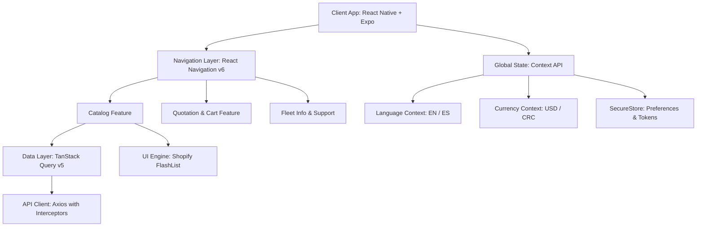

# CJ Trucks Parts · Mobile Application

<div align="center">


<p align="center">
  <b>High-performance cross-platform mobile catalog and quotation workflow for heavy-duty commercial truck parts.</b>
</p>

</div>

---

## 📌 Overview

**CJ Trucks Parts** is a production-grade enterprise mobile application engineered for commercial transport fleets, independent mechanics, and heavy-duty truck operators. The application bridges the gap between physical warehouse inventory and fleet operations by providing instant part discovery, OEM reference validation, multi-currency pricing, and streamlined quotation requests directly to sales representatives.

Designed with a **frictionless B2B philosophy**, users can explore full technical specifications, inspect high-resolution part photography, and submit quotation inquiries without the overhead of mandatory account creation or intrusive tracking.

---

## ✨ Key Features

### 🚛 Heavy-Duty Parts Catalog
- **11 Commercial Categories:** Engines, Transmissions, Differentials, Brake Systems, Suspensions, Electrical, Cooling, Body & Cab, Steering, Exhaust & Emissions, and Pneumatics.
- **High-Performance Rendering:** Utilizes `@shopify/flash-list` for smooth 60/120 FPS recycling list performance over large inventories.
- **Instant Search & Filtration:** Rapid query engine filtering by commercial part names, categories, and OEM part numbers.

### 🌐 Internationalization & Localization (i18n)
- **Bilingual Interface:** Full native support for English (`en`) and Spanish (`es`) with dynamic runtime switching.
- **Dual Currency Engine:** Real-time price display toggling between US Dollars (`$ USD`) and Costa Rican Colones (`₡ CRC`).

### 🛒 Quotation & Order Generation
- **Inquiry Cart:** Add multiple items with quantities and custom specifications.
- **Direct Dispatch:** Instant quotation export connecting directly to sales specialists via integrated secure communication channels.

### 🛡️ Privacy & Compliance by Design
- **Zero-Friction Access:** No forced sign-up, password storage, or social media linking required to access the catalog.
- **Store Compliant:** Fully configured to comply with Apple App Store Review Guidelines and Google Play Store policies (Zero Advertising ID collection, strict permission sandboxing).

---

## 🛠️ Architecture & Tech Stack



### Core Technologies
| Layer | Technology | Purpose |
| :--- | :--- | :--- |
| **Runtime & Framework** | [React Native 0.86](https://reactnative.dev/) / [Expo](https://expo.dev/) | Cross-platform native core with modern architecture |
| **Language** | [TypeScript 6.0](https://www.typescriptlang.org/) | End-to-end static typing and domain contracts |
| **Navigation** | [React Navigation v6](https://reactnavigation.org/) | Native Stack and Bottom Tabs navigation |
| **Server State** | [TanStack React Query v5](https://tanstack.com/query/latest) | Asynchronous data caching, synchronization, and retry policies |
| **HTTP Client** | [Axios](https://axios-http.com/) | REST client with interceptors for token handling |
| **Virtualized Lists** | [@shopify/flash-list](https://shopify.github.io/flash-list/) | High-performance recycling list implementation |
| **Storage** | `expo-secure-store` | Hardware-backed secure persistence for device preferences |

---

## 📁 Project Structure

```
MillstruckserviceApp/
├── assets/                  # Application icons, splash screens, and store media
│   ├── app-store/           # Apple App Store submission assets & screenshots
│   └── google-play/         # Google Play Store feature graphics & icons
├── src/
│   ├── api/                 # HTTP client configuration and network utilities
│   ├── components/ui/       # Atomic and reusable UI components
│   ├── context/             # Global application state (Currency, Theme)
│   ├── features/            # Domain-driven feature modules
│   │   ├── cart/            # Quotation cart management and state
│   │   ├── catalog/         # Products catalog, filters, details, and hooks
│   │   ├── info/            # Business information, warranty, and terms
│   │   └── orders/          # Order dispatch, quote history, and services
│   ├── i18n/                # Localization dictionary and LanguageContext
│   └── navigation/          # Root navigation, bottom tabs, and screen routes
├── app.json                 # Expo application manifest (iOS/Android bundles)
├── eas.json                 # Expo Application Services (EAS) build pipelines
├── package.json             # Dependencies and build scripts
└── tsconfig.json            # TypeScript compiler configuration
```

---

## 🚀 Getting Started

### Prerequisites
- **Node.js:** `>= 20.x` (Recommended: LTS)
- **Package Manager:** `npm` or `yarn`
- **Expo CLI:** `npx expo`
- **EAS CLI (for builds):** `npm install -g eas-cli`

### Installation

1. **Clone the repository:**
   ```bash
   git clone https://github.com/RJMadrigal/MillsTruckApp.git
   cd MillsTruckApp
   ```

2. **Install project dependencies:**
   ```bash
   npm install
   ```

3. **Configure environment variables:**
   ```bash
   cp .env.example .env
   ```

4. **Verify TypeScript compilation:**
   ```bash
   npm run ts:check
   ```

### Running Locally

Start the Expo development server:
```bash
npm start
```

From the interactive CLI, you can:
- Press `i` to launch on the **iOS Simulator** (macOS with Xcode required).
- Press `a` to launch on an **Android Emulator** or connected Android device.
- Scan the displayed QR code with the **Expo Go** or custom development client app.

---

## 📦 Building for Production (EAS)

The project is pre-configured with **EAS Build** profiles for both platforms.

### Android (Google Play)
```bash
# Generate production Android App Bundle (.aab)
npx eas-cli build -p android --profile production
```

### iOS (Apple App Store & TestFlight)
```bash
# Generate production iOS Archive (.ipa)
npx eas-cli build -p ios --profile production
```

---

## 📄 License & Attribution

Copyright © 2026 **Mills Truck Service / CJ Trucks Parts**. All rights reserved.  
Engineering & Mobile Development by **Josue Madrigal** ([@RJMadrigal](https://github.com/RJMadrigal)).
